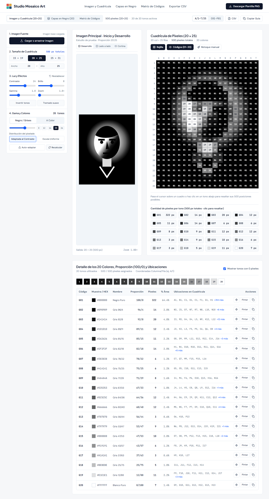

# 🎨 Studio Mosaico Art

**Conversor de imágenes a cuadrículas de píxeles con coordenadas, conteo de piezas y proporciones de tono para murales físicos, carpintería artística, mosaicos y bricolaje.**

🔗 **[Probar la aplicación en vivo aquí](https://github.io)**

## ✨ ¿Para qué sirve?
A diferencia de los editores de pixel art tradicionales diseñados solo para pantallas, **Studio Mosaico Art** está pensado para llevar diseños digitales al mundo físico (como murales hechos con cubos de madera de 5×5 cm, mosaicos cerámicos o tejidos).

## 🛠️ Características principales
- **Control total de resolución:** Define el tamaño exacto de tu cuadrícula (columnas × filas) y calcula las dimensiones físicas finales de tu obra.
- **Paleta personalizable (Escala de grises y Color):** Ajusta la cantidad exacta de tonos, contraste, brillo, gamma y distribución de tonos.
- **Tabla de taller y mezcla de pintura:** Obtén el código HEX, la proporción de mezcla (ej. blanco/negro), la cantidad exacta de piezas por tono y sus coordenadas específicas (`A1, B2, C3...`).
- **Vistas especializadas de ensamblaje:**
  - **Imagen y Cuadrícula:** Vista general con rejilla, códigos y herramienta de retoque manual píxel a píxel.
  - **Capas en Negro:** Aísla cada tono para pintar o clasificar bloques por lotes sin errores.
  - **Matriz de Códigos:** Mapa técnico limpio ideal para imprimir y llevar al taller.
- **Exportación lista para imprimir:** Descarga la plantilla completa en **PNG** de alta calidad o exporta todos los datos a una hoja de cálculo **CSV**.

## 🚀 Cómo usarla en tus proyectos físicos
1. **Sube una imagen** (idealmente con buen contraste o siluetas icónicas).
2. **Configura la cuadrícula** según la cantidad de bloques o piezas que tengas disponibles.
3. **Revisa la tabla de tonos** para preparar tus mezclas de pintura y separar la cantidad exacta de cubos por color.
4. **Descarga la plantilla PNG o CSV** y ensambla tu obra siguiendo las coordenadas fila por fila.

## 💻 Tecnologías utilizadas
- React + TypeScript
- Vite
- Tailwind CSS
- Procesamiento de imagen en HTML5 Canvas (100% en el navegador, sin subir tus fotos a servidores externos).
